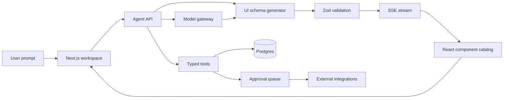

# Building a Fast Generative-UI Product Like Agently

## Executive answer

The fastest credible route is **not** to let a model write and execute arbitrary React code. Build a conventional Next.js application, give the model a small catalog of approved components, require it to return a validated JSON UI specification, and stream that specification into a deterministic renderer. Add agent tools, durable jobs, approvals, and company knowledge only after the basic prompt-to-interface loop works.

For an Agently-like first version, the best speed-to-control stack is:

- **Frontend:** Next.js, React, Tailwind CSS, shadcn/ui
- **Generative UI:** `json-render` for catalog-constrained JSON-to-UI rendering, or Tambo if a more integrated React agent/UI system is preferred
- **Model gateway:** Vercel AI SDK
- **Application data:** Supabase Postgres, Auth, Storage, and pgvector
- **Agent communication:** Server-Sent Events initially; adopt AG-UI when interoperability becomes useful
- **Agent runtime:** a small typed tool loop first; LangGraph or Temporal only when workflows need pause/resume, schedules, retries, and approvals
- **Integrations:** Nango for open-source/self-hostable OAuth infrastructure or Composio for the broadest rapid tool coverage
- **Local/open-weight model option:** Ollama with a model that performs structured output and tool calling reliably

This architecture can produce a narrow, polished MVP quickly while preserving a migration path toward the broader Agently product model.

## What “like Agently” means

Agently is more than a chat interface. Its current product organizes work around a movable **Canvas**, a prioritized **Needs you** queue, persistent work items and routines, a company **Brain**, generated **Pages**, connected applications, and approval gates for consequential actions.[^1][^2][^3]

Its Pages can contain documents, presentations, spreadsheets, code, and interactive HTML or React artifacts; Jarvis can create and edit these outputs. Agently also describes more than 100 OAuth-connected services and maintains approval and audit behavior around external actions. Accordingly, an Agently-like system has four different layers:[^4][^5][^6]

1. **Adaptive interface:** The agent decides which cards, forms, tables, or artifacts should appear.
2. **Agent runtime:** The model plans, calls tools, and updates state.
3. **Durable workspace:** Tasks, artifacts, sources, runs, and approvals persist independently of chat.
4. **Integration and trust layer:** OAuth, scoped permissions, audit logs, and human approval govern real-world actions.

Generative UI addresses only the first layer. A convincing product needs all four, but they should not all be built at once.

## Generative-UI patterns

| Pattern | How it works | Speed | Control | Best use |
|---|---|---:|---:|---|
| Controlled/tool UI | The model calls a known tool; the client maps its typed result to a predefined React component | Fastest | Highest | Search results, approval cards, email drafts, task status |
| Declarative UI | The model emits JSON describing a tree assembled from an allow-listed component catalog | Fast | High | Dashboards, reports, forms, personalized workspaces |
| Open-ended UI | A model or external server generates HTML or another complete interface, rendered in a sandbox | Slower | Lower | One-off calculators, mini-apps, rich artifacts |

CopilotKit describes the same continuum: developer-authored components offer the most predictability, declarative A2UI offers creativity inside a catalog, and MCP Apps provide greater expressive range with harder security, accessibility, and branding guarantees. AG-UI is the event-based connection between an agent and user-facing application, while A2UI and related specifications describe what UI should be rendered.[^7][^8][^9]

**Recommended product mix:** use controlled components for actions and approvals, declarative JSON UI for dashboards and workspaces, and sandboxed open-ended artifacts only for isolated “Pages.” This hybrid mirrors the useful parts of Agently without treating every screen as model-generated.

## Best open-source options

| Project | What it provides | Best reason to choose it | Limitation |
|---|---|---|---|
| **Vercel `json-render`** | Catalog-constrained JSON UI, streaming, React and other renderers, prebuilt shadcn components | Best default for safe, fast declarative UI | It is the UI composition layer, not a full agent backend |
| **Tambo** | React SDK plus backend for conversations, state, agent execution, streaming, and MCP | Fastest integrated React generative-UI path | More framework opinion and dependency than a small renderer |
| **CopilotKit + AG-UI** | Agent-to-frontend protocol, state streaming, tools, components, A2UI, MCP Apps | Best for interoperability and sophisticated agent UX | More concepts and moving parts for a small MVP |
| **assistant-ui** | Production React chat primitives, tools, approvals, sources, attachments, and generative UI | Best if polished chat is the center of the product | Workspace/canvas semantics remain application work |
| **Vercel AI SDK** | Provider-neutral model calls, streaming, tools, structured objects, and UI hooks | Best low-level TypeScript foundation | Requires assembling persistence, workflows, and product UI |
| **OpenIntelligentUI** | Cloneable MIT-licensed generative-UI application using CopilotKit and AG-UI | Best reference implementation to study or fork | A showcase, not a complete Agently clone |

`json-render` constrains model output to a developer-defined catalog, validates it against schemas, and progressively renders the result while it streams; it supports React, Vue, Svelte, Solid, and React Native, with prebuilt shadcn components available. That is the strongest default where brand consistency and safe rendering matter.[^10][^11]

Tambo is open source and self-hostable, registers React components with schemas, and handles streaming, state, MCP, conversation state, and agent execution. It can reduce assembly work if the application will remain React-centric.[^12][^13]

CopilotKit supports component tools, backend tool rendering, state rendering, A2UI, MCP Apps, and custom component libraries. Its AG-UI layer carries messages, tool events, state, and lifecycle events over an event-based connection, which helps avoid a proprietary frontend/backend message format.[^14][^15][^16][^9]

assistant-ui provides open-source React chat primitives and already covers streaming, tools, approval, sources, attachments, voice, and generative UI. Its generative-UI package exposes a component vocabulary through one typed `present` tool, including cards, tables, charts, tabs, timelines, citations, diagrams, maps, forms, and controls.[^17][^18]

OpenIntelligentUI is an MIT-licensed reference app that can be cloned and adapted; it uses CopilotKit and AG-UI and includes a sandboxed UI-generation path. It is especially useful for learning the complete data flow before writing a custom implementation.[^19]

## Recommended MVP architecture



### Frontend

Build a stable application shell rather than generating the entire product:

- Left navigation: **Work, Brain, Pages, Integrations, Settings**
- Main workspace: movable/resizable cards or a simple responsive grid
- Right drawer: agent conversation and run details
- Global command bar: create task, ask agent, open artifact
- Fixed UI states: empty, loading, streaming, tool running, waiting for approval, failed, completed

The model should control the **contents of work cards and artifacts**, not authentication screens, billing, security settings, or primary navigation.

### UI contract

Start with 10–15 components:

- `Stack`, `Grid`, `Card`, `Heading`, `Text`
- `Metric`, `Table`, `Timeline`, `StatusBadge`
- `Form`, `TextInput`, `Select`, `DatePicker`
- `ApprovalCard`, `ArtifactLink`, `SourceList`

Each component receives schema-validated props. A small specification might look like:

```json
{
  "root": "task_review",
  "elements": {
    "task_review": {
      "type": "Stack",
      "props": { "gap": "md" },
      "children": ["summary", "approval"]
    },
    "summary": {
      "type": "Card",
      "props": {
        "title": "Client update ready",
        "body": "Draft created from the latest project activity"
      }
    },
    "approval": {
      "type": "ApprovalCard",
      "props": {
        "actionId": "act_123",
        "risk": "external_send",
        "confirmLabel": "Review and send"
      }
    }
  }
}
```

The renderer looks up each `type` in a local registry. Unknown types fail closed; invalid props are rejected; actions are symbolic IDs resolved by trusted application code. No generated JavaScript is evaluated.

### Agent loop

Keep the first loop explicit:

1. Receive user intent and current workspace state.
2. Select or call a typed data/action tool.
3. Produce a typed domain result.
4. Choose a known UI template or generate a catalog-constrained UI specification.
5. Validate the specification.
6. Stream patches to the client.
7. Persist the final spec, data snapshot, run events, and sources.
8. Route consequential actions to an approval record rather than executing immediately.

Vercel’s documented generative-UI pattern maps model tool results to custom React components, while multi-step loops allow the model to call tools, process results, and then synthesize an answer. This pattern is easier to debug than asking one model call to reason, fetch data, perform actions, and invent a full interface simultaneously.[^20][^21]

### Data model

Use ordinary relational records as the source of truth:

- `workspaces`
- `memberships`
- `threads`
- `messages`
- `tasks`
- `runs`
- `run_events`
- `artifacts`
- `ui_specs`
- `tool_connections`
- `tool_calls`
- `approvals`
- `sources`
- `documents`
- `document_chunks`
- `memories`

Store UI specifications as versioned JSON, but store approvals, tasks, and permissions as typed relational data. Supabase can keep embeddings beside transactional records through the pgvector extension and supports similarity search with standard Postgres operators.[^22][^23]

## Open models

The UI framework is usually more important than the model. The model must reliably perform **structured output, tool selection, instruction following, and repair after validation errors**.

For local development, Ollama supports JSON-schema-constrained structured outputs, including schemas produced from Zod or Pydantic, and recommends lower temperature for more deterministic responses. Ollama also supports tool calling for compatible models and exposes an OpenAI-compatible interface.[^24][^25][^26][^27]

Practical local candidates include:

- **Qwen coder/general models:** useful where schema generation and code-oriented instructions dominate
- **Llama-family instruct models:** broad ecosystem and common tool-calling examples
- **gpt-oss models:** available through Ollama and shown in its structured-output documentation

These should be described as **open-weight** unless the exact model license has been reviewed for the intended commercial use. Model size should be selected through evaluation rather than reputation: test valid-schema rate, correct component selection, correct action arguments, latency, and repair success on the application’s own prompt set.

For the fastest launch, use a strong hosted model behind a provider-neutral gateway and add Ollama as an optional provider. Swapping models later is much easier when the UI and tools are controlled by stable schemas.

## Integrations and actions

Agently-like value comes from reading and acting across external systems, but OAuth integration work can overwhelm an MVP. Nango is open source and self-hostable, handles OAuth, credential storage, token refresh, multi-tenant connections, syncs, triggers, and tools across a large API catalog. Composio provides SDK adapters for major agent frameworks and a broad catalog of pre-authenticated toolkits, which can be faster if managed infrastructure is acceptable.[^28][^29][^30]

Use a strict action policy:

| Action class | Examples | Default behavior |
|---|---|---|
| Read | Search email, fetch calendar, read CRM | Execute with logged permission |
| Draft | Draft email, prepare CRM update | Execute and show preview |
| External write | Send email, create public post, modify CRM | Require explicit approval |
| Destructive/high-risk | Delete, pay, merge, revoke access | Always require fresh approval; some actions should remain blocked |

This follows the product lesson visible in Agently’s approval design: the user sees the exact proposed action and may allow once, allow a category where appropriate, or deny; deletes and other sensitive actions receive stricter treatment.[^6][^31]

## Durability and schedules

Do not add complex orchestration on day one. A database-backed queue with idempotency keys, retries, and run events is sufficient for initial synchronous and short background tasks.

Add LangGraph when the agent requires an explicit multi-step graph, persistent checkpoints, pause/resume, and human intervention. Its persistence approach can resume a workflow after interruption, but side effects must be isolated in idempotent tasks or nodes so replay does not duplicate actions.[^32][^33]

Add Temporal when workflows may wait for hours or days, survive deployments and crashes, coordinate multiple services, or require strong operational guarantees. Temporal records execution history and can resume workflows after failures or prolonged human-approval waits. It is powerful but unnecessary overhead for an early prompt-to-card prototype.[^34][^35]

## Fastest build sequence

### Phase 1: Two-day proof

- Scaffold Next.js, Tailwind, shadcn/ui, authentication, and Postgres.
- Create five domain components: task card, source list, editable draft, approval card, and artifact link.
- Implement one model endpoint with streaming and Zod-validated tool arguments.
- Support one user request: “Research this topic and prepare a brief.”
- Save the run, sources, brief, and UI spec.

**Exit condition:** a prompt streams a useful, interactive result using only approved components.

### Phase 2: One-week MVP

- Add Work list, task detail, agent drawer, and Pages/artifact view.
- Add one integration, ideally Gmail, Slack, Notion, or Google Calendar.
- Add one external-write action with preview and approval.
- Add file upload and basic retrieval over workspace documents.
- Add run-event logging, retry, cancel, and visible error states.
- Create a 30–50-case evaluation set for UI validity, action safety, and answer quality.

**Exit condition:** a user can request work, watch it run, review sourced output, approve one real action, and reopen the persisted result.

### Phase 3: Weeks two to four

- Expand the component catalog only from observed user needs.
- Add routines/schedules, notifications, and durable checkpoints.
- Introduce a movable canvas only if users need spatial organization; otherwise retain a faster list/board UI.
- Add additional integrations through Nango or Composio.
- Introduce AG-UI if multiple agent runtimes or frontend clients need a common event protocol.
- Add sandboxed artifact generation for calculators, diagrams, and mini-tools.

## Instructions for implementation

### Step 1: Define domain tools

Each tool should have a narrow name, a Zod input schema, a typed result, a permission class, and an idempotency policy. Keep model-facing descriptions short and unambiguous.

```ts
const createDraft = tool({
  description: "Create an editable draft; never send it",
  inputSchema: z.object({
    recipient: z.string().email(),
    subject: z.string().max(120),
    body: z.string().max(10000)
  }),
  execute: async (input) => saveDraft(input)
});
```

### Step 2: Define the component catalog

Give each component a schema and a renderer. Avoid allowing raw class names, URLs, HTML, event-handler strings, or arbitrary styles in model-generated props.

```ts
const catalog = {
  Metric: {
    schema: z.object({
      label: z.string(),
      value: z.string(),
      trend: z.enum(["up", "down", "flat"]).optional()
    }),
    render: Metric
  },
  ApprovalCard: {
    schema: z.object({
      actionId: z.string(),
      summary: z.string(),
      risk: z.enum(["external_send", "write", "destructive"])
    }),
    render: ApprovalCard
  }
};
```

### Step 3: Separate data from presentation

The research tool should return research data; the presentation tool should receive that data and choose a UI. This permits replacing the UI model, caching research, and rerendering the same facts in different formats.

### Step 4: Stream meaningful events

Stream domain events rather than raw tokens only:

- `run.started`
- `step.started`
- `tool.called`
- `tool.result`
- `ui.patch`
- `approval.requested`
- `artifact.created`
- `run.completed`
- `run.failed`

AG-UI standardizes messages, state updates, tool calls, and lifecycle events over an event-based frontend/backend connection, making it a useful model when the home-grown event format begins to grow.[^36][^14]

### Step 5: Validate twice

Validate model output on the server before persistence and again in the client before rendering. On failure, ask the model once to repair the specification with the validation errors; after that, fall back to a safe text/card representation.

### Step 6: Keep actions server-side

A rendered button should submit an `actionId` to the server. The server reloads the action, checks workspace membership and policy, verifies approval state and idempotency, then executes. Never trust model-generated action arguments arriving directly from the browser.

### Step 7: Evaluate the system

Track:

- Valid UI schema rate
- Time to first visible component
- Complete render latency
- Correct component selection
- Tool-call success and repair rates
- Unauthorized-action attempts blocked
- Approval acceptance/rejection rate
- Task completion rate
- User edits before approval

A generative UI that looks impressive but frequently chooses the wrong action is a product failure. Safety and task completion should outweigh visual novelty.

## What not to build

- **Do not execute generated JSX in the main application context.** Use an allow-listed catalog or a sandboxed iframe for open-ended artifacts.
- **Do not let the model define authorization.** Permissions come from server-side policy and workspace records.
- **Do not begin with dozens of integrations.** One complete read-draft-approve-act loop is more valuable.
- **Do not make every view generative.** Navigation, settings, billing, identity, and destructive-action controls should remain deterministic.
- **Do not adopt multi-agent orchestration prematurely.** A single model loop with explicit tools is easier to observe and improve.
- **Do not make vector retrieval the only memory.** Keep authoritative facts, permissions, tasks, and action state in relational tables; use embeddings for discovery.

## Recommended choice

For the shortest path to an Agently-style prototype, use **Next.js + Vercel AI SDK + `json-render` + shadcn/ui + Supabase**, with a single model, one integration, and an approval-gated external action. `json-render` supplies the constrained generative surface, AI SDK supplies streaming and tools, and Postgres supplies durable product state.[^37][^10][^22]

If the product’s central experience is a sophisticated in-app agent rather than a generated workspace, choose **CopilotKit + AG-UI**. If the goal is the least assembly work for a React-only product, prototype with **Tambo**. If chat quality is the first priority, begin with **assistant-ui** and add declarative workspace rendering second.

The right first demo is not “generate any app.” It is: **“Tell the agent a business task; watch a sourced result become an interactive card or page; review the proposed real-world action; approve it; reopen the complete run later.”** That demonstrates generative UI, agent action, memory, trust, and persistence in one narrow workflow.

---

## References

1. [Documentation — Agently](https://agently.dev/docs) - Welcome to Agently: Jarvis, one AI agent that plans work, reasons over your company knowledge and ac...

2. [Core Concepts, Docs - Agently](https://agently.dev/docs/core-concepts) - Its Canvas holds Needs you: everything waiting on you, ranked the way you would rank it, from approv...

3. [Work](https://agently.dev/docs/work) - Work is home base in Agently: the Canvas with Needs you, Your day, Routines, Site health and more, a...

4. [Pages](https://agently.dev/docs/pages) - Pages holds your documents, presentations, spreadsheets, live HTML and React pages, code and files. ...

5. [Integrations — Docs — Agently](https://agently.dev/docs/integrations) - Agently integrations: connect email, calendar, CRM, docs and messaging through secure OAuth in Brain...

6. [Approvals](https://agently.dev/docs/approvals) - Jarvis asks before it sends, deletes, archives or merges anything. Approval cards show in the chat, ...

7. [AG-UI Overview - Agent User Interaction Protocol](https://docs.ag-ui.com/introduction)

8. [Mcp Apps (special Case)](https://www.copilotkit.ai/ag-ui-and-a2ui) - Learn about AG-UI, the User Interaction protocol, and A2UI, a generative UI specification. Discover ...

9. [Generative UI - CopilotKit](https://docs.copilotkit.ai/angular/concepts/generative-ui-overview) - How CopilotKit lets agents drive UI — the primitives it ships, what each one is for, and how to pick...

10. [GitHub - vercel-labs/json-render: The Generative UI framework](https://github.com/vercel-labs/json-render) - The Generative UI framework. Contribute to vercel-labs/json-render development by creating an accoun...

11. [github.com · vercel-labs · json-renderjson-render/README.md at main · vercel-labs/json-render](https://github.com/vercel-labs/json-render/blob/main/README.md) - The Generative UI framework. Contribute to vercel-labs/json-render development by creating an accoun...

12. [Tambo AI - Generative UI SDK for React - GitHub](https://github.com/tambo-ai/tambo) - Generative UI SDK for React. Contribute to tambo-ai/tambo development by creating an account on GitH...

13. [Introducing Tambo 1.0](https://tambo.co/blog/posts/introducing-tambo-generative-ui) - Tambo 1.0 is for building generative UI into React apps

14. [AG-UI - docs.copilotkit.ai](https://docs.copilotkit.ai/langgraph-fastapi/agentic-protocols/ag-ui) - Bring your agents from any framework to your users through AG-UI and CopilotKit.

15. [AG-UI](https://docs.copilotkit.ai/ag2/ag-ui) - The AG-UI protocol connects your frontend to your AI agents via event-based Server-Sent Events (SSE)...

16. [Generative UI - docs.copilotkit.ai](https://docs.copilotkit.ai/agent-spec/generative-ui) - Let your agent generate interactive UI components

17. [Generative UI](https://www.assistant-ui.com/docs/tools/generative-ui) - Let the model compose an interface at runtime from a component vocabulary you ship, using the presen...

18. [assistant-ui · The frontend library for AI agents](https://www.assistant-ui.com/) - Open-source React components and runtimes for building AI chat. Streaming, tools, and persistence in...

19. [CopilotKit/OpenGenerativeUI: Open-Source Generative UI ...](https://github.com/CopilotKit/OpenGenerativeUI) - Open-Source Generative UI Framework. Contribute to CopilotKit/OpenIntelligentUI development by creat...

20. [Update Your Chat Page](https://vercel.com/academy/ai-sdk/multi-step-and-generative-ui) - Build chatbots that perform complex tasks requiring multiple tool calls. Manage conversation state a...

21. [Generative User Interfaces - AI SDK by Vercel](https://vercel-ai.mintlify.app/ai-sdk-ui/generative-user-interfaces)

22. [Vector columns](https://supabase.com/docs/guides/ai/vector-columns) - Learn how to use vectors within your own Postgres tables

23. [supabase.com](https://supabase.com/modules/vector.md)

24. [Structured Outputs - Ollama documentation](https://docs.ollama.com/capabilities/structured-outputs)

25. [Structured outputs · Ollama Blog](https://ollama.com/blog/structured-outputs) - Ollama now supports structured outputs making it possible to constrain a model's output to a specifi...

26. [docs.ollama.com](https://docs.ollama.com/llms.txt)

27. [Blog](https://ollama.com/blog) - Ollama news, announcements, open model releases, product updates, tutorials, and technical guides.

28. [Composio - GitHub](https://github.com/composiohq) - Composio equips agents with well-crafted tools empowering them to tackle complex tasks - Composio

29. [GitHub - NangoHQ/nango: Connect your agents & product to ...](https://github.com/NangoHQ/nango) - Connect your agents & product to 1,000 APIs. Contribute to NangoHQ/nango development by creating an ...

30. [Composio powers 1000+ toolkits, tool search, context ... - GitHub](https://github.com/composiohq/composio) - Composio powers 1000+ toolkits, tool search, context management, authentication, and a sandboxed wor...

31. [Security & Privacy — Docs - Agently](https://agently.dev/docs/security-and-privacy) - Agently security and privacy: passwordless sign-in, workspace data isolation, OAuth integrations, va...

32. [github.com · oss · langgraphlangchain-ai-docs/src/oss/langgraph/durable-execution.mdx at ...](https://github.com/miraland-labs/langchain-ai-docs/blob/main/src/oss/langgraph/durable-execution.mdx) - Unified LangChain documentation. Contribute to miraland-labs/langchain-ai-docs development by creati...

33. [Runtimes, frameworks, and harnesses - Docs by LangChain](https://docs.langchain.com/oss/python/concepts/products)

34. [Durable AI | Temporal Documentation](https://docs.temporal.io/ai) - Build durable AI agents and systems on Temporal, with runnable cookbook recipes, SDK integrations, a...

35. [How the Temporal Platform Works](https://temporal.io/how-it-works) - See exactly how Temporal uses workflows to guarantee successful execution of services and applicatio...

36. [AG-UI - CopilotKit Docs](https://docs.copilotkit.ai/agno/ag-ui) - The AG-UI protocol connects your frontend to your Agno agents via event-based Server-Sent Events (SS...

37. [AI SDK - Vercel](https://vercel.com/ai-sdk) - Build AI applications and agents with the AI SDK, the TypeScript toolkit for model providers, stream...

